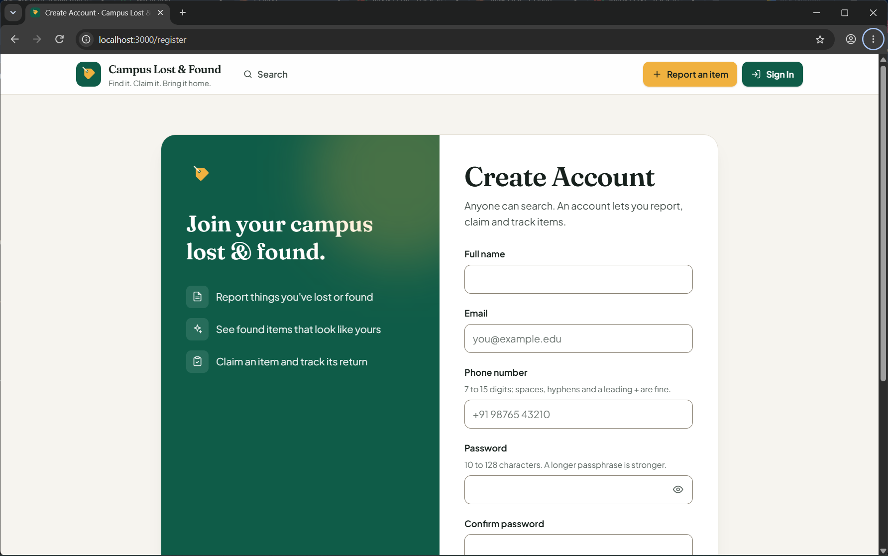
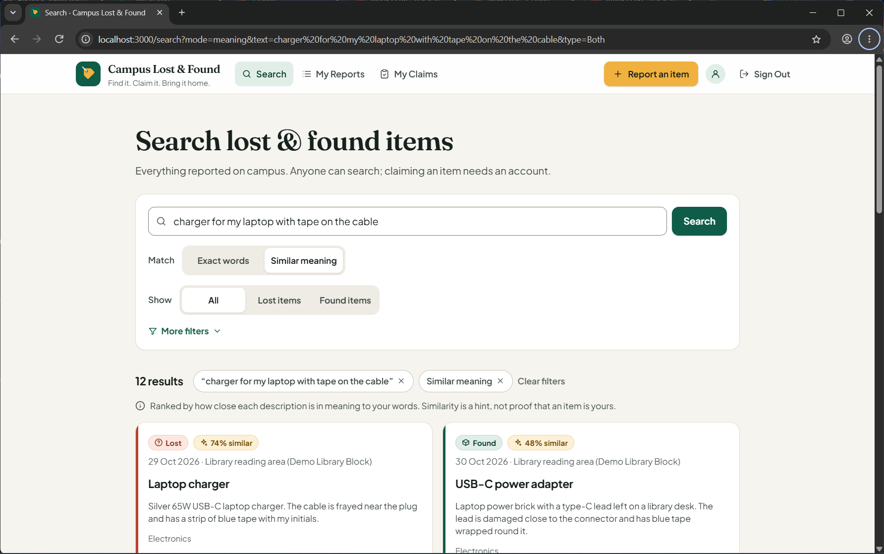
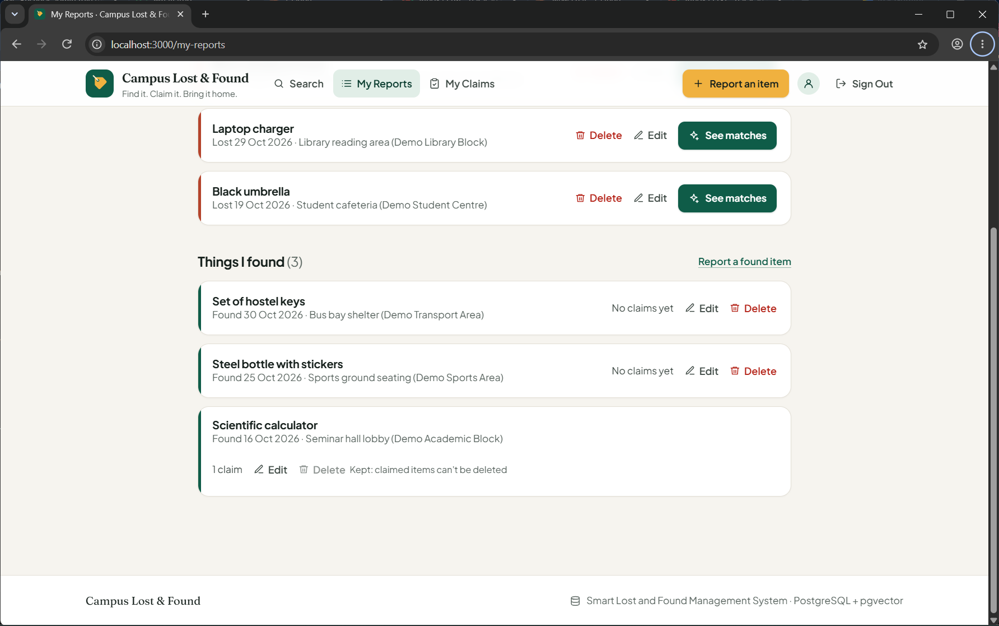
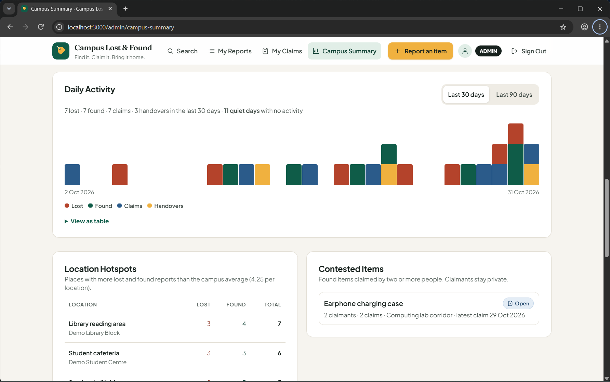

# Smart Lost and Found Management System

A college DBMS Level 3 project (UE24CS351A Database Management System) that brings lost-item reports, found-item reports, claims, supporting evidence and receipt confirmations into one application. PostgreSQL holds the relational records and enforces role-based access control; the pgvector extension in the same PostgreSQL server stores description embeddings, so differently worded reports of the same item can be found by meaning — without treating similarity as proof of ownership.

Team: Paras Agarwal (PES1UG24CS316) and Rahul Bellary (PES1UG24CS357), Section F. See [docs/contribution_matrix.md](docs/contribution_matrix.md).

## Features and workflow

Home (`/`), Search (`/search`), Sign In (`/login`) and Create Account (`/register`) are public; everything else requires an account.

1. **Create Account** (`/register`): full name, email, phone and a password of 10–128 characters (confirmed). Every public registration creates a **USER** account: there is no role field, and the database function `register_user` inserts the constant role `USER`. The password is hashed with Argon2id before it reaches the database. Duplicate emails (any letter case) are rejected.
2. **Sign In / Sign Out**: Argon2id verification, encrypted HTTP-only session cookie holding only `User_ID`; the role is re-read from PostgreSQL on every request.
3. **Lost Report** / **Found Report** (`/lost-report`, `/found-report`): item name, description (up to 2,000 characters), category, location and date (not in the future). A 384-dimension embedding is generated before saving.
4. **My Reports** (`/my-reports`, `/my-reports/edit`): edit own reports (SQL `UPDATE`; changed text fires the embedding-invalidation trigger and the same transaction stores a fresh vector) and **delete** them after a confirmation (stored procedure `delete_own_report`: the report and its vector are removed; a found report someone has claimed is kept, with an explanation).
5. **Search** (`/search`): **Exact words** (default; text, category, location, Lost/Found/All, newest/oldest) or **Similar meaning** (the search text is embedded with the same model and lost and found reports are ranked by cosine similarity through the HNSW indexes; 3–200 characters; a percentage badge and a "hint, not proof" note).
6. **Possible matches** (`/potential-matches`): up to ten found reports ranked by exact cosine similarity for one of your lost reports.
7. **My Claims** (`/claim`): claim eligible found items, follow each claim's next step, and **withdraw** a claim without a handover (stored procedure `withdraw_claim`).
8. **Claim Evidence** (`/claim/evidence`) and **Handover** (`/claim/handover`): description-only evidence and a typed receipt acknowledgement; one handover per found item.
9. **Campus Summary** (`/admin/campus-summary`, ADMIN only, read-only): totals, return share, reports by category/location, a **daily activity timeline** (recursive CTE, quiet days shown, 30 or 90 days), **location hotspots** (HAVING above the campus average), **contested items** (HAVING two or more claimants) and recent activity. It reads only `admin_*` database objects through a separate read-only login.

## Screenshots

Genuine captures from this project's production build with fictional demo data: application screenshots of the real Chrome window and source-code screenshots from VS Code (selected examples are in `docs/screenshots/`).

| | |
| --- | --- |
|  Create Account |  Similar-meaning search |
|  My Reports with delete rules |  Campus Summary analytics |

## Technology stack

- Next.js 16.3.8 App Router (Server Components and Server Actions), React 19.3.0, TypeScript 6.0.3, Tailwind CSS 4.3.3.
- PostgreSQL 18 with the pgvector 0.8.6 extension; direct parameterised SQL through `pg` connection pools, without an ORM.
- Hugging Face Transformers.js (`@huggingface/transformers`, all-MiniLM-L6-v2) for embeddings, run on the server.
- Zod validation, Argon2id password hashing (`argon2`), `iron-session` encrypted cookie sessions.
- ESLint, TypeScript type checking, and Node.js test scripts (database, RBAC, features, HNSW, real browser).

## Database architecture

Ten relations in PostgreSQL's `public` schema (quoted identifiers preserve the approved spelling): `USER`, `CATEGORY`, `LOCATION`, `LOST_REPORT`, `FOUND_REPORT`, `FOUND_PHOTOS`, `MATCHES`, `CLAIM`, `CLAIM_EVIDENCE` (weak entity), `HANDOVER`. Primary/foreign keys, NOT NULL foreign keys, named UNIQUE and CHECK constraints (role, unique and well-formed lower-case email, non-blank item names, evidence numbering, one claim per user per item), `DEFAULT CURRENT_DATE` for claim and receipt dates, and `ON DELETE CASCADE` only for derived/multivalued data (MATCHES, FOUND_PHOTOS); claims, evidence and handovers are protected by NO ACTION keys. Details: [db/README.md](db/README.md).

### Database-level role-based access control

The application never connects as a superuser. `lib/db.ts` uses the login `lf_web`, which has **no privileges of its own** (NOINHERIT) and, for each query, opens one transaction that sets the role (`lf_anon` for visitors or `lf_user` for signed-in accounts) and the user ID with transaction-local `set_config`, so pooled connections never carry one request's identity into another. Admin analytics use a second, read-only login (`lf_admin_web` → `lf_admin`) through `lib/admin-db.ts`, only after a server-side ADMIN check; `lf_web` is not a member of `lf_admin`. Column-level GRANTs, REVOKEs from PUBLIC, and Row-Level Security on LOST_REPORT, FOUND_REPORT, CLAIM, HANDOVER and CLAIM_EVIDENCE make PostgreSQL itself enforce ownership; narrow SECURITY DEFINER functions handle login, session lookup, registration and the two cross-user facts the workflows need.

### Embeddings and similarity

`Xenova/all-MiniLM-L6-v2` encodes the trimmed item name and description (mean pooling, normalised, 384 values) into `"Embedding" VECTOR(384)`. `find_potential_matches` ranks found reports exactly by cosine similarity (`1 - (a <=> b)`); the public similar-meaning search uses `ORDER BY "Embedding" <=> $1 LIMIT k`, which PostgreSQL answers from the HNSW indexes once the tables are large enough (verified with `EXPLAIN (ANALYZE, BUFFERS)` on 4,000 synthetic vectors per table).

### Advanced DBMS concepts implemented

- **Transactions and locking:** every query runs in a transaction; claim, evidence, handover, edit, withdrawal and deletion lock parent rows in a consistent order; savepoints recover from random-ID collisions; `db/transactions.sql` demonstrates commit and rollback.
- **Views:** report-detail views and five admin analytics views.
- **Stored functions and procedures:** `get_claim_summary`, `find_potential_matches`, `admin_daily_activity`, the security functions, and the procedures `withdraw_claim` and `delete_own_report` (called with `CALL`).
- **Trigger:** clears a report's embedding when its text changes.
- **Queries:** joins, nested and correlated subqueries, ordinary and recursive CTEs, GROUP BY with meaningful HAVING, aggregates with FILTER.
- **Indexing:** primary-key/unique indexes, two B-tree indexes and two HNSW cosine indexes.

## Project structure

```text
app/
  actions/             # Server Actions: auth, register, reports, edit, delete, claims/withdraw, evidence, handover
  register/            # Create Account page and form
  login/               # Sign In
  lost-report/ found-report/ search/ potential-matches/
  my-reports/          # Own reports, edit/, delete confirmation
  claim/               # My Claims, evidence/, handover/
  admin/campus-summary/# ADMIN-only analytics
components/            # Header/navigation, UI primitives, forms, icons, report form
lib/                   # db (pools + roles), admin-db, auth, session, password, embedding, search, semantic-search, …
db/                    # Setup, migrations, RBAC, security functions, procedures, analytics, verification, seeds
scripts/               # provision-account.mjs (ADMIN provisioning), backfill-embeddings.mjs
tests/                 # support (isolated test DB), handover, rbac, features, vector-index, polish-browser
docs/                  # Report, diagrams (.drawio + PNG), screenshots, evidence logs, submission PDF/DOCX
```

## Prerequisites

- Node.js **22.13.0 or newer** and npm.
- PostgreSQL **18** with pgvector **0.8.6** installed on the server, and the `psql`, `createdb`, `pg_dump` tools.
- A PostgreSQL owner role (e.g. `postgres`) for setup, migrations and maintenance.
- Network access for the embedding model's first download (cached afterwards).

## Local setup

```sh
npm ci
```

1. **Create the database and objects** in the order given in [db/README.md](db/README.md#fresh-installation-setup-order) (this includes `roles.sql`, which creates the least-privilege roles), then set the two login passwords privately: `psql … -c "\password lf_web"` and `psql … -c "\password lf_admin_web"`. Existing databases use the migration order in the same file — take a backup first.
2. **Configure** `.env.local` (copy `.env.example`; never commit it):

   | Variable | Value |
   | --- | --- |
   | `DATABASE_URL` | `lf_web` login → `smart_lost_found` |
   | `ADMIN_DATABASE_URL` | `lf_admin_web` login → `smart_lost_found` |
   | `MAINTENANCE_DATABASE_URL` | owner login (scripts and tests only; never read by the app) |
   | `SESSION_SECRET` | random secret of at least 32 characters |

3. **Accounts.** Users create their own USER accounts at `/register`. Create the first ADMIN (and any further ones) only from a terminal with the owner connection:

   ```sh
   npm run provision:admin -- --name "Campus Desk" --email desk@example.edu
   ```

   It prompts twice for the password without echoing it (or use `--generate-password --credentials-file .local/demo-credentials.txt` to write a random password only to that git-ignored file). It refuses an existing email and never changes or deletes existing accounts. There is no web page or API that can create an ADMIN.
4. **Embeddings for seed data:** `npm run db:backfill-embeddings`.
5. **Run:** `npm run dev`, then open <http://localhost:3000>.

## Testing

All test scripts run against the isolated clone **`smart_lost_found_test`** only: `tests/support.mjs` rewrites every connection to that database and refuses to continue unless all three connections reach it (and the two application logins are not superusers). Create or refresh it while no one is connected to the source database:

```powershell
dropdb --if-exists -h localhost -U postgres smart_lost_found_test
createdb -h localhost -U postgres -T smart_lost_found smart_lost_found_test
```

```sh
npm run lint
npm run typecheck
npm test              # handover/workflow (39), RBAC + RLS (9), features (6), HNSW (2) checks
npm run build
npm run test:browser  # + 14 real-browser checks; needs a production server on 127.0.0.1:3102
                      #   (pointed at smart_lost_found_test) and Chrome with --remote-debugging-port=9224
```

Each suite inserts temporary fixtures through the owner connection, removes them, and compares all ten tables with their pre-test contents. The final verification results are summarised in the project report.

### Demo database

`smart_lost_found_demo` is a fresh install of the scripts plus `db/seed.sql`, two provisioned accounts (one ADMIN, one USER created through `register_user`) and `db/demo_seed.sql`; see [docs/demo_checklist.md](docs/demo_checklist.md). Demo credentials live only in the git-ignored `.local/demo-credentials.txt`.

## Current limitations

- Login rate limiting is not implemented, and a copied session cookie stays valid until it expires (8 hours).
- Rules that need the current date or several tables (dates not in the future, one handover per found item) are enforced by the application and row locks, not CHECK constraints.
- Evidence is description-only (no uploads); handover is a typed acknowledgement; there is no claim approval workflow and `Status` columns stay NULL.
- Similarity suggests potential matches only; it never proves ownership. At the current data volume PostgreSQL uses a sequential scan for vector search; the HNSW indexes take over at larger volumes.
- RLS protects against application logic errors; it does not replace parameterised queries (the transaction-local identity is set by the application).

## Project references

- [College requirements](docs/DBMS%20Level%203%20Project%20Requirements.pdf)
- [ER diagram](docs/lost_found_ER_diagram.drawio) ([PNG](docs/diagrams/er_diagram.png)) · [Relational schema](docs/lost_found_relational_schema.drawio) ([PNG](docs/diagrams/relational_schema.png)) · [Architecture](docs/architecture.drawio) ([PNG](docs/diagrams/architecture.png))
- [Project report](docs/project_report.md)
- [Database documentation](db/README.md) · [Demonstration checklist](docs/demo_checklist.md) · [Contribution matrix](docs/contribution_matrix.md)
