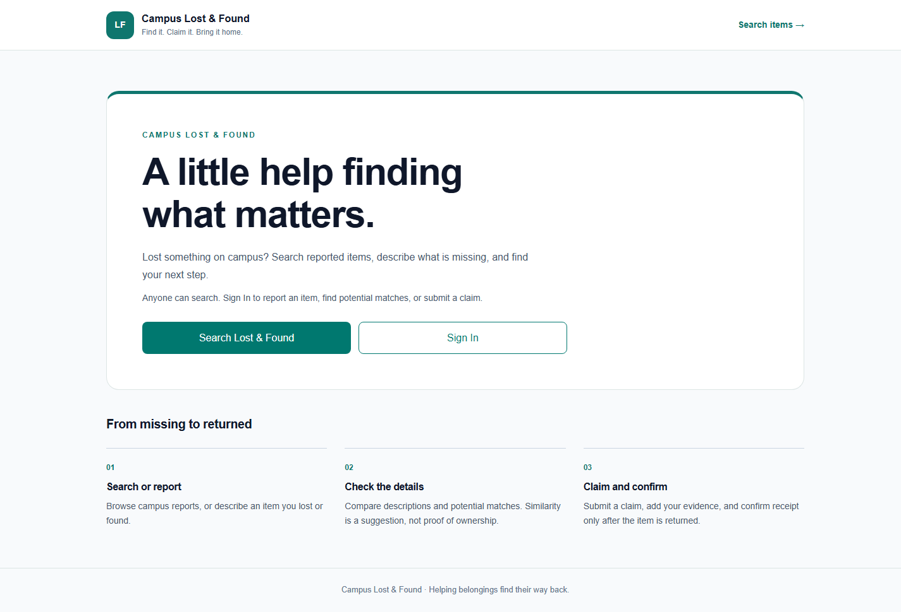
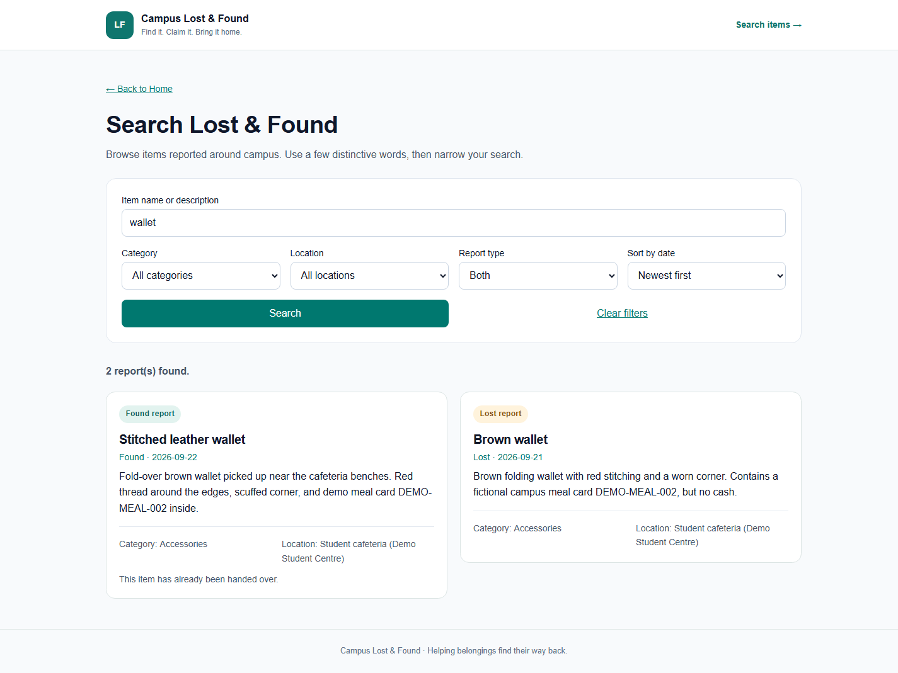
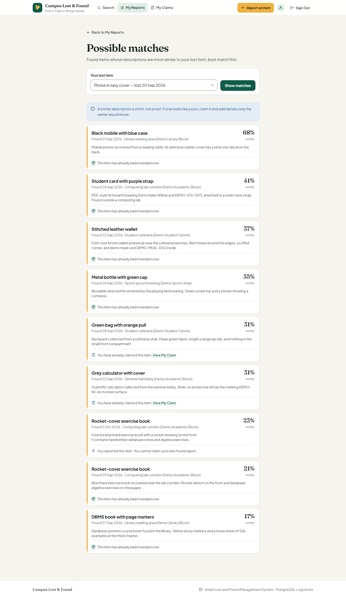
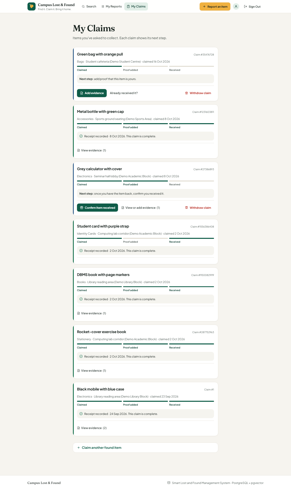
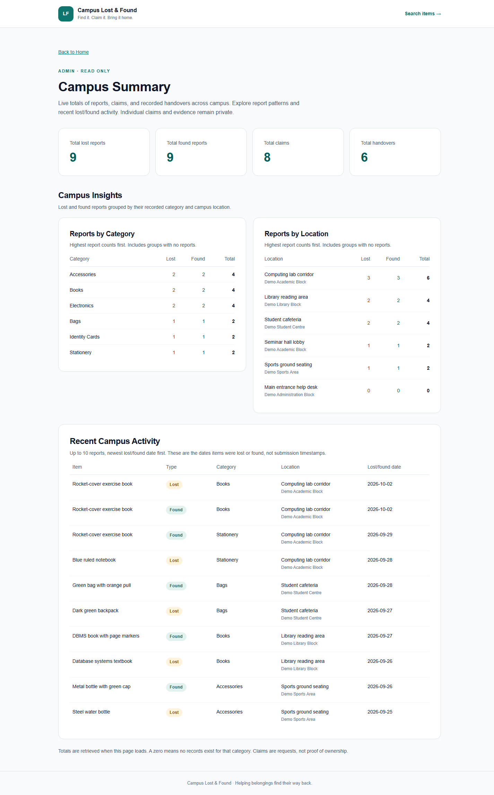
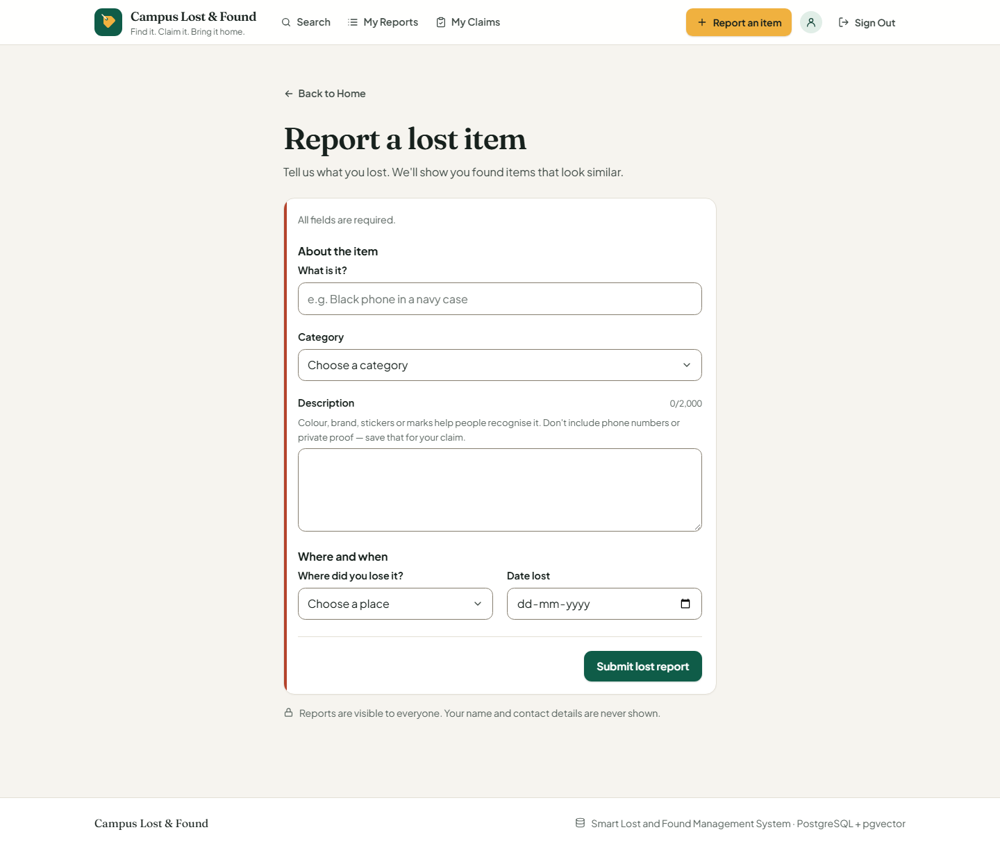
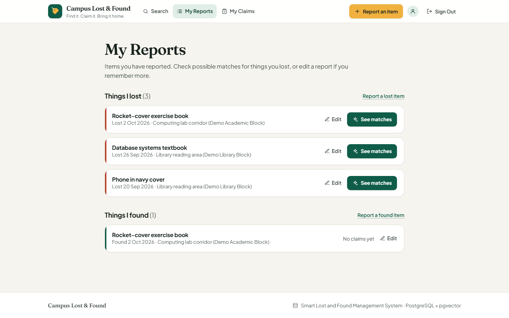
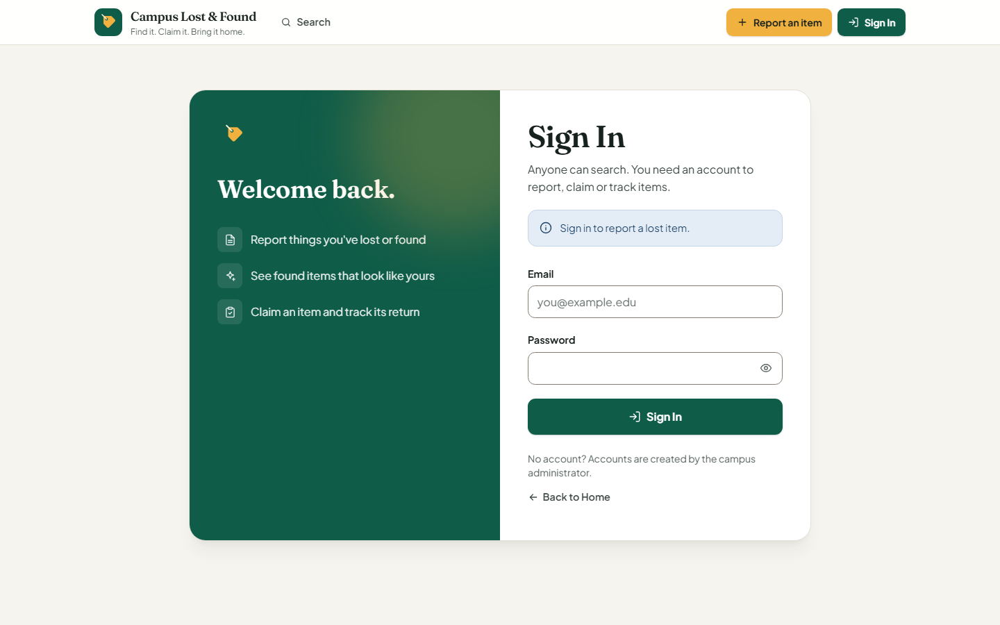

# Smart Lost and Found Management System

A college DBMS Level 3 project that brings lost-item reports, found-item reports, claims, supporting evidence, and receipt confirmations into one application. Description-based matching helps users discover possible matches without treating similarity as proof of ownership.

## Features and workflow

Home (`/`) and Search (`/search`) are public. Login is available at `/login`; reporting, My Reports, potential matches, claims, evidence, and handover require authentication.

1. **Lost Report** (`/lost-report`): enter an item name, description (up to 2,000 characters), category, location, and date lost (not in the future). An embedding is generated before saving.
2. **Found Report** (`/found-report`): enter the same information with a date found and generate an embedding.
3. **My Reports** (`/my-reports`, `/my-reports/edit`): list your own lost and found reports with their embedding state, claim count and handover state, and **edit** them (SQL `UPDATE`). Changing the name or description fires the embedding-invalidation trigger and the same transaction stores a fresh vector. Found reports with a recorded handover are closed for edits.
4. **Search** (`/search`): search item names/descriptions, filter by category, location, or Lost/Found/All, and sort by newest or oldest date. Category, location and sort order sit under **More filters** (opened automatically when one is in use); active filters appear as removable chips.
5. **Possible matches** (`/potential-matches`, reached from **See matches** in My Reports or after reporting a lost item): pick one of your lost reports and view up to ten found reports ranked by cosine similarity, shown in plain language as a percentage with where/when it was found and its claim action. A short note explains that similarity is a hint, not proof. Retrieval is read-only and does not create `MATCHES`, claims, or handovers.
6. **My Claims** (`/claim`): each of your claims shows a progress line derived from evidence and handover rows (no status value is stored) and one **next step** with a single primary button (add evidence → confirm received). Arriving from **Claim this item** opens a focused claim form at the top; otherwise the form sits in a collapsed “Claim another found item” section. A claim without a handover can be **withdrawn** (SQL `DELETE` of its evidence and the claim in one transaction). Search and Potential Matches can preselect an eligible found report. The claimant comes from the session, the date is database-generated, and `Status` remains NULL. Another user's claim without a handover does not block yours.
7. **Claim Evidence** (`/claim/evidence`): add a trimmed description of 1–255 characters to your own claim and view existing evidence grouped by claim. `File_Path` is saved as NULL and is not displayed. The page offers the form only for open claims; once the item has been handed over, the claim's evidence is shown read-only (the server action itself is unchanged).
8. **Handover** (`/claim/handover`): confirm receipt for your own eligible claim with a trimmed text acknowledgement of 1–100 characters. The database supplies the date. Each claim can have at most one handover, and the application locks the shared found report so only one of its claims can complete a handover. Evidence is not required, and claim status is not an eligibility condition.
9. **Campus Summary** (`/admin/campus-summary`): ADMIN-only, read-only totals, the share of found items handed over, category and location report counts with stacked bars, and recent lost/found activity. It does not show private claims or change any report.

Navigation is organised around tasks: **Search**, **My Reports**, **My Claims** (and **Campus Summary** for ADMIN), plus a highlighted **Report an item** menu (lost or found). Evidence and handover are reached from each claim, and possible matches from each lost report, so they don't crowd the header. Below 1280px the header collapses into an accessible menu. When a visitor opens a page that needs an account, Sign In explains why and returns them there afterwards (`?next=`, accepted only for known in-app paths, so it cannot redirect off-site). Forms keep input on failure (error messages say so), show per-field errors linked with `aria-describedby`, move focus to the first invalid field, disable the submit button while pending (preventing duplicate submissions) and show the next step after success. Routes have loading skeletons, a 404 page and an error boundary.

## Screenshots

Captured from the running production build with fictional demo data (October 2026):

| | |
| --- | --- |
|  Home |  Search (found items) |
|  Possible matches |  My Claims |
|  ADMIN Campus Summary |  Report form |
|  My Reports |  Sign In |

## Design system

`app/globals.css` defines the tokens (exposed to Tailwind through `@theme`) and a small set of component classes; `components/` holds the shared React pieces (`ui.tsx`, `form.tsx`, `icons.tsx`, `site-header.tsx`, `report-form.tsx`).

- **Colour:** warm paper background `#f6f4ef`, ink `#17211d`; brand/found **evergreen** `#0f5c48`; accent **marigold** `#f0b13f`; lost **terracotta** `#b4432b`; claims **slate blue** `#2b5b8a`. Each report card has a coloured rail so lost, found, match, claim and completed states are distinguishable at a glance (always with a text badge as well, never colour alone).
- **Type:** Fraunces (display headings) and Plus Jakarta Sans (UI), self-hosted by `next/font`.
- **Accessibility:** all text pairs meet WCAG AA (most AAA; e.g. muted text 5.9:1, placeholders 4.8:1, white on brand 7.9:1); form borders meet 3:1 (4.1:1); visible focus rings; 44px touch targets; skip link; `prefers-reduced-motion` respected; SVG icons are decorative (`aria-hidden`).

## Technology stack

- Next.js 16.3.8 App Router, React 19.3.0, TypeScript 6.0.3, and Tailwind CSS 4.3.3.
- PostgreSQL 18 with pgvector 0.8.6; direct SQL through the `pg` connection pool, without an ORM.
- Hugging Face Transformers.js (`@huggingface/transformers`) for embeddings.
- Zod validation, Argon2id password hashing, and `iron-session` encrypted cookie sessions.
- ESLint and npm scripts for linting, type checking, development, and production builds.

## Database architecture

The ten relations live in PostgreSQL's `public` schema. Quoted identifiers preserve the approved spelling. Primary and foreign keys enforce relationships; foreign keys use `NO ACTION`, without cascading deletes. IDs are supplied explicitly; application-created reports, claims, and handovers use positive `crypto.randomInt` IDs with bounded primary-key collision retries.

| Table | Purpose |
| --- | --- |
| `USER` | User identity, role, contact fields, and password hash |
| `CATEGORY` | Report categories |
| `LOCATION` | Locations and buildings |
| `LOST_REPORT` | Lost-item reports and embeddings |
| `FOUND_REPORT` | Found-item reports and embeddings |
| `FOUND_PHOTOS` | Photo references; composite key `(Found_ID, Photo_URL)` |
| `MATCHES` | Stored lost/found associations; composite key `(Lost_ID, Found_ID)` |
| `CLAIM` | Claimant and the found report being claimed |
| `CLAIM_EVIDENCE` | Weak entity with key `(Claim_ID, Evidence_No)`; `Evidence_No` is the partial key |
| `HANDOVER` | Receipt acknowledgement; required, unique `Claim_ID` references `CLAIM` |

Named CHECK and UNIQUE constraints also validate roles, unique emails, non-blank item names, evidence numbering and one claim per user per item ([details](db/README.md#integrity-constraints-check-and-unique)). The unique handover `Claim_ID` enforces the approved 1:1 relationship: a handover belongs to one claim, and a claim may have zero or one handover. Photo references and stored matches exist in the schema/demo data; the application does not upload photos or automatically persist vector results into `MATCHES`.

### Embeddings and similarity

The application uses `Xenova/all-MiniLM-L6-v2`, the Transformers.js model distribution of all-MiniLM-L6-v2. It encodes the trimmed item name and description separated by a newline, using CPU inference, mean pooling, and normalization. Both report tables store 384-dimensional embeddings as `VECTOR(384)`.

`find_potential_matches(lost_id, limit)` excludes NULL/zero-norm embeddings, calculates cosine similarity as `1 - cosine distance` using pgvector's `<=>` operator, and ranks by increasing distance with `Found_ID` as the tie-breaker. It performs exact ranking with no similarity threshold or status filter. HNSW indexes support direct approximate distance queries; the current materialized exact-ranking function does not use those indexes to accelerate its ranking.

### Advanced DBMS concepts implemented

- **Transactions and locking:** claim, evidence, handover, report-edit and claim-withdrawal actions use `BEGIN`/`COMMIT`/`ROLLBACK` on a checked-out client. Withdrawal and handover lock `FOUND_REPORT` then `CLAIM` in the same order, so they cannot deadlock. Parent-row locks serialize competing submissions. Savepoints support claim/handover ID collision retries. Evidence numbering uses `MAX(Evidence_No) + 1` under the claim lock, with an INT overflow guard. `db/transactions.sql` separately demonstrates atomic commit and rollback.
- **Views:** `v_lost_report_details` and `v_found_report_details` join category/location details; the found view aggregates photo counts. Neither exposes password hashes or embeddings.
- **Stored functions:** `get_claim_summary(claim_id)` returns claim/found IDs, evidence count, and optional handover ID. `find_potential_matches` provides vector retrieval. Both are read-only, `STABLE`, and `SECURITY INVOKER`; application authorization remains necessary.
- **Triggers:** changes to `Item_Name` or `Description` invalidate a report's embedding by setting it to NULL. The app's Edit report workflow exercises this live and stores the regenerated vector in a second `UPDATE` within the same transaction.
- **DML coverage in the application:** `INSERT` (reports, claims, evidence, handover), `SELECT` (all pages), `UPDATE` (edit report) and `DELETE` (withdraw claim with its evidence).
- **Indexing:** primary-key/unique indexes, B-tree indexes on `CLAIM.Found_ID` and `MATCHES.Found_ID`, and HNSW cosine indexes on both report embeddings.

## Authentication and security

Passwords are hashed and verified with Argon2id. Encrypted sessions contain only `User_ID`; authenticated requests reload the user and role from PostgreSQL. Cookies are HTTP-only, SameSite=Lax, valid for eight hours, and Secure in production.

Database/session helpers are server-only. Queries use parameters, inputs are validated on the server, and actions obtain identity from the authenticated session rather than browser fields. Only claim owners can add evidence or record receipt, including ADMIN users; there is no admin override. Missing and foreign claims receive the same safe error. Public search selects report information without user contact fields, password hashes, or embeddings. Search runs in server-only code (`lib/search.ts`) rather than as a publicly callable Server Action.

## Project structure

```text
app/
  actions/             # Server Actions: auth, reports, report edit, claims/withdraw, evidence, handover
  login/               # Login page/form
  lost-report/         # Lost report page/form
  found-report/        # Found report page/form
  search/              # Public search
  potential-matches/   # Owned lost-report similarity results
  my-reports/          # Own reports list and edit/
  claim/               # My Claims, submission, withdrawal, evidence/, handover/
  admin/campus-summary/# ADMIN-only campus totals and activity
  page.tsx             # Homepage/navigation
components/            # Design-system components: header/nav, UI primitives, forms, icons, report form
lib/                   # Database, auth, session, password, embedding, matching, search, report writes
scripts/               # backfill-embeddings.mjs (fills NULL report embeddings)
tests/                 # Database/action regression suite and optional real-browser checks
db/                    # Schema, seed, verification, views, functions, triggers, indexes
docs/                  # College requirements, report, demo checklist, diagrams, screenshots
.env.example           # Empty environment-variable template
```

## Prerequisites

- Node.js **22.13.0 or newer** and npm, matching `package.json`.
- PostgreSQL **18**, the `psql`/`createdb` tools, and pgvector **0.8.6** installed on the database server. Schema/verification scripts enforce these versions and the database name `smart_lost_found`.
- A PostgreSQL role authorized to create the local database/objects and enable the extension.
- Network access for the embedding model's initial download; later runs can reuse its local cache.

## Local setup

Run commands from the repository root. Install the locked dependencies:

```sh
npm ci
```

### 1. Create and initialize the database

This PowerShell example uses the local `postgres` role. PostgreSQL can prompt for its password; keep credentials out of commands and tracked files. Run against a **new database**, not an existing database containing application data.

```powershell
createdb -h localhost -U postgres smart_lost_found
psql -X -h localhost -U postgres -d smart_lost_found -v ON_ERROR_STOP=1 -c "CREATE EXTENSION vector WITH SCHEMA public VERSION '0.8.6';"

$scripts = @('schema.sql', 'views.sql', 'functions.sql', 'triggers.sql', 'indexes.sql', 'vector_search.sql', 'verify.sql', 'seed.sql')
foreach ($script in $scripts) {
    psql -X -h localhost -U postgres -d smart_lost_found -v ON_ERROR_STOP=1 -f "db/$script"
    if ($LASTEXITCODE -ne 0) { throw "Database setup failed: $script" }
}
```

**Upgrading a database created before 2026-10-16:** run `db/constraints.sql` once to add the named integrity constraints (it refuses to run if existing rows conflict, and is a no-op on fresh installs).

`schema.sql`, relational/vector index creation, and `seed.sql` are one-time operations and must not be blindly rerun. Seed data contains fictional users, categories, locations, reports, matches, evidence, and handovers. `verify.sql` is read-only and checks tables, columns, nullability, keys, and the vector extension. See [database documentation](db/README.md) for script details.

`db/transactions.sql` is an optional demonstration, **not part of normal setup**. It requires an empty `smart_lost_found` database, temporarily commits fixtures, demonstrates rollback, and cleans up. Run it to completion before seeding, without concurrent application writes.

### 2. Configure the application

If `.env.local` does not already exist, copy the empty template and fill it privately:

```powershell
Copy-Item .env.example .env.local
```

| Variable | Required value |
| --- | --- |
| `DATABASE_URL` | `postgresql://<username>:<URL-encoded-password>@<host>:<port>/smart_lost_found` |
| `SESSION_SECRET` | Independently generated random secret of at least 32 characters |

Do not overwrite an existing configured `.env.local`. Never commit it or prefix these variables with `NEXT_PUBLIC_`. Production requires HTTPS for Secure session cookies.

### 3. Provision a login account

Seed users have **unusable password-hash placeholders**, not demo login credentials. On a fresh seeded database, provision one USER and one ADMIN account locally before the demo. The password helper is implemented in `lib/password.ts`; there is no registration page. A demo ADMIN account was provisioned in the original development database, but it is not part of the portable seed and its password is not documented here.

For each fresh seed account, generate an Argon2id hash locally with the installed `argon2` package. This PowerShell example prompts without echoing the password and passes it to Node through standard input; it does not write plaintext to a file:

```powershell
$secure = Read-Host 'Choose a local demo password' -AsSecureString
$pointer = [Runtime.InteropServices.Marshal]::SecureStringToBSTR($secure)
try {
    $plain = [Runtime.InteropServices.Marshal]::PtrToStringBSTR($pointer)
    $hash = $plain | node -e "const a=require('argon2');let s='';process.stdin.on('data',c=>s+=c);process.stdin.on('end',async()=>console.log(await a.hash(s.replace(/\r?\n$/,''),{type:a.argon2id})))"
} finally {
    Remove-Variable plain,secure -ErrorAction SilentlyContinue
    [Runtime.InteropServices.Marshal]::ZeroFreeBSTR($pointer)
}
$hash  # Copy this generated hash privately into the psql step below.
```

Open `psql` on the new `smart_lost_found` database, assign the generated hash to a **seed placeholder account only**, and confirm one row was updated. For example, seed `User_ID = 1` is a USER account; seed `User_ID = 6` is an ADMIN account. Repeat with a different password/hash for the second role. In the interactive `psql` session:

```sql
\set demo_hash '<paste the generated Argon2id hash here>'
UPDATE public."USER" SET "Password_Hash" = :'demo_hash'
WHERE "User_ID" = 1 AND "Role" = 'USER'
  AND "Password_Hash" = 'DEMO_HASH_PLACEHOLDER_NOT_FOR_LOGIN';
```

Do not run that update against an existing account with a real hash. Clear the temporary `$hash` variable after provisioning (`Remove-Variable hash`) and keep passwords and hashes out of tracked files, slides, screenshots, and logs. Use only the credentials you provisioned locally to sign in.

### 4. Generate embeddings for the seed data

Seed reports are inserted without vectors. Once `.env.local` is configured, fill them so Possible matches has candidates (one transaction; only NULL embeddings are touched; the first run downloads the model):

```sh
npm run db:backfill-embeddings
```

### 5. Start the application

```sh
npm run dev
```

Open [http://localhost:3000](http://localhost:3000). Stop the server with Ctrl+C.

## Validation and production

```sh
npm run typecheck
npm run lint
npm run build
npm start
```

`npm start` serves the completed production build. Run `npm test` (`node tests/handover.mjs`) for the database/action regressions, and `npm run test:browser` for real-browser coverage; this requires a running production server at `http://127.0.0.1:3102` and an isolated Chrome debugging endpoint at `http://127.0.0.1:9224` by default. Both modes use the configured development database and temporary fixtures, so run only against a backed-up local test database without concurrent writes. See the setup comments in `tests/handover.mjs` and `tests/polish-browser.mjs`. These scripts are not required to initialize the database.

## Current limitations

- Seeded reports have NULL embeddings until `npm run db:backfill-embeddings` is run (see [db/README.md](db/README.md#embedding-backfill-data-only-no-schema-change)). Editing a report in the app regenerates its vector; text changed outside the app stays NULL until edited or backfilled.
- Rules that need the current date or more than one table (dates not in the future, one handover per found item) are enforced by the application and row locks rather than CHECK constraints; see [Integrity constraints](db/README.md#integrity-constraints-check-and-unique).
- Similarity suggests potential matches only; it never proves ownership, approves claims, or automatically marks an item returned. Claim/report status values remain NULL in new submissions; no status workflow is implemented.
- Evidence is description-only; file/photo uploads, digital signatures, administrative editing, and approval workflows are not implemented. Handover records a simple claimant acknowledgement. The ADMIN page is read-only.
- Login rate limiting is not implemented. Logout deletes the browser cookie; a previously copied stateless session cookie cannot be revoked before expiry.

## Project references and team

- [College requirements](docs/DBMS%20Level%203%20Project%20Requirements.pdf)
- [ER diagram](docs/lost_found_ER_diagram.drawio) (editable Draw.io; [PNG](docs/diagrams/er_diagram.png))
- [Relational schema](docs/lost_found_relational_schema.drawio) (editable Draw.io, including PK/FK/UNIQUE/CHECK markers; [PNG](docs/diagrams/relational_schema.png))
- [Project report](docs/project_report.md)
- [Demonstration checklist](docs/demo_checklist.md)
- [Viva study guide](docs/viva_guide.md)

Earlier diagram drafts were removed from the working tree to avoid confusion; they remain in the Git history. **Team details: [Add team member names, student IDs, and guide details here.]** No verified team roster is recorded in the repository.
