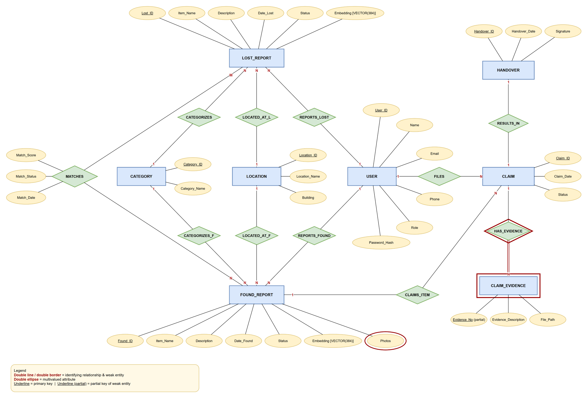
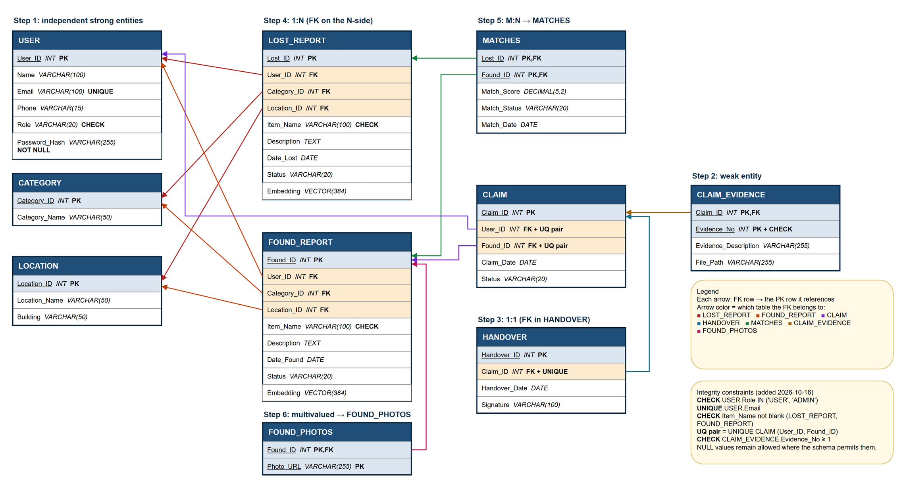

# Smart Lost and Found Management System — DBMS Level 3 project report

This report follows Section 14 of the [college brief](DBMS%20Level%203%20Project%20Requirements.pdf). The design artifacts are the editable [ER diagram](lost_found_ER_diagram.drawio) and [relational schema](lost_found_relational_schema.drawio) (open them in diagrams.net/draw.io); the PNG images below are exported from those files. Earlier drafts are not kept in the repository; they remain available in the Git history.

**Submission details to complete personally:** the brief calls for a two-member team approved by the instructor. Add the actual student names and IDs, each member's database/application contributions, guide/instructor identification, college/course cover-page details, and submission date. The repository does not establish those facts.

## 1. Problem, objectives, scope, and functional requirements

Campus lost-item information is often fragmented. Someone who finds an item may not know who lost it; someone who loses an item may struggle to locate relevant found reports. This application gives both parties a searchable record and a traceable claim-to-handover path.

The objectives are to record lost and found reports with category and campus location; find reports with text/filters or description-based similarity; let authenticated users claim eligible found items and add evidence; record one completed handover per found item; and give ADMIN a read-only view of aggregate campus activity. Similarity is only a suggestion, never proof of ownership.

In scope: Sign In/Sign Out, public search, authenticated report creation, owned lost-report potential matches, own-claim history/submission, evidence, receipt confirmation, and ADMIN Campus Summary. Out of scope: registration, uploads, notifications, payments, maps, claim approval, and a new report-status lifecycle. Existing nullable status fields are not used to invent workflow values.

| Functional requirement | Implemented route or action |
| --- | --- |
| Authenticate and distinguish USER/ADMIN | `/login`, `app/actions/auth.ts`, `lib/auth.ts` |
| Record lost/found reports | `/lost-report`, `/found-report`, report server actions |
| Review and edit own reports (UPDATE) | `/my-reports`, `/my-reports/edit`, `app/actions/report-edit.ts` |
| Browse and filter reports | `/search`, `lib/search.ts` |
| Suggest similar found items for one's lost report | `/potential-matches`, `public.find_potential_matches` |
| Submit, review and withdraw own claims (INSERT/DELETE) | `/claim`, `app/actions/claim.ts` (`createClaim`, `withdrawClaim`) |
| Add/view own claim evidence | `/claim/evidence`, `app/actions/claim-evidence.ts` |
| Confirm an eligible receipt once per found item | `/claim/handover`, `app/actions/handover.ts` |
| Review campus aggregates without private claim data | `/admin/campus-summary` (ADMIN only) |

## 2. Database selection and design

PostgreSQL 18 provides relational primary/foreign keys, transactions, row locks, SQL views and functions, triggers, and indexes in one database. pgvector 0.8.6 stores and compares the 384-dimensional report embeddings in that same relational design. This satisfies the brief's SQL-plus-vector requirement without a second database. Direct parameterized SQL through `pg` keeps the database operations visible for a DBMS demonstration.

The approved ER and relational diagrams define ten tables. `USER` has the role field; `CATEGORY` and `LOCATION` are lookup tables; the two report tables carry item details and embeddings; `FOUND_PHOTOS` and `MATCHES` are existing design relations; `CLAIM` links a claimant to a found report; `CLAIM_EVIDENCE` is a weak entity numbered within a claim; and `HANDOVER` references a claim. Primary/foreign keys, required report/claim links, and unique `HANDOVER.Claim_ID` appear in [schema.sql](../db/schema.sql). The additional application rule of at most one handover across all claims for a found report is enforced in a transaction by locking that `FOUND_REPORT` row before checking/inserting.

### ER diagram



Editable source: [`docs/lost_found_ER_diagram.drawio`](lost_found_ER_diagram.drawio) (open in diagrams.net / draw.io) · Image: [`docs/diagrams/er_diagram.png`](diagrams/er_diagram.png)

Eight entities (seven strong, one weak) and eleven relationships in Chen notation, which map to the ten tables: blue rectangles are entities, green diamonds relationships, yellow ellipses attributes. `CLAIM_EVIDENCE` is a weak entity (double border) identified through `HAS_EVIDENCE` (double diamond, total participation shown by the double line); `Photos` is a multivalued attribute (double ellipse); `MATCHES` is the M:N relationship between lost and found reports and carries its own attributes. Cardinalities appear on each relationship line.

### Relational schema



Editable source: [`docs/lost_found_relational_schema.drawio`](lost_found_relational_schema.drawio) (open in diagrams.net / draw.io) · Image: [`docs/diagrams/relational_schema.png`](diagrams/relational_schema.png)

Each box is a table; arrows run from a foreign-key column to the primary key it references, coloured by the table that owns the foreign key. Bold markers show PK, FK, UNIQUE and CHECK; the note lists the six named integrity constraints. The "Step" labels follow the ER-to-relational mapping: strong entities, weak entity, 1:1, 1:N, M:N and the multivalued attribute.

### Data dictionary

`PK` means primary key, `FK` foreign key, `UQ` unique, `CK` a named CHECK constraint, and `NN` explicitly not null. Primary-key components are inherently not null. Other attributes are nullable unless marked. All identifiers below are the exact quoted PostgreSQL names.

| Relation | Columns: type and key/requirement |
| --- | --- |
| `USER` | `User_ID` INT PK; `Name` VARCHAR(100); `Email` VARCHAR(100) UQ; `Phone` VARCHAR(15); `Role` VARCHAR(20) CK (USER/ADMIN); `Password_Hash` VARCHAR(255) NN |
| `CATEGORY` | `Category_ID` INT PK; `Category_Name` VARCHAR(50) |
| `LOCATION` | `Location_ID` INT PK; `Location_Name` VARCHAR(50); `Building` VARCHAR(50) |
| `LOST_REPORT` | `Lost_ID` INT PK; `User_ID` INT FK→`USER` NN; `Category_ID` INT FK→`CATEGORY` NN; `Location_ID` INT FK→`LOCATION` NN; `Item_Name` VARCHAR(100) CK (not blank); `Description` TEXT; `Date_Lost` DATE; `Status` VARCHAR(20); `Embedding` VECTOR(384) |
| `FOUND_REPORT` | `Found_ID` INT PK; `User_ID` INT FK→`USER` NN; `Category_ID` INT FK→`CATEGORY` NN; `Location_ID` INT FK→`LOCATION` NN; `Item_Name` VARCHAR(100) CK (not blank); `Description` TEXT; `Date_Found` DATE; `Status` VARCHAR(20); `Embedding` VECTOR(384) |
| `FOUND_PHOTOS` | `Found_ID` INT FK→`FOUND_REPORT`, PK part; `Photo_URL` VARCHAR(255), PK part |
| `MATCHES` | `Lost_ID` INT FK→`LOST_REPORT`, PK part; `Found_ID` INT FK→`FOUND_REPORT`, PK part; `Match_Score` DECIMAL(5,2); `Match_Status` VARCHAR(20); `Match_Date` DATE |
| `CLAIM` | `Claim_ID` INT PK; `User_ID` INT FK→`USER` NN; `Found_ID` INT FK→`FOUND_REPORT` NN; `Claim_Date` DATE; `Status` VARCHAR(20); UQ (`User_ID`, `Found_ID`) |
| `CLAIM_EVIDENCE` | `Claim_ID` INT FK→`CLAIM`, PK part; `Evidence_No` INT PK part, CK (≥ 1); `Evidence_Description` VARCHAR(255); `File_Path` VARCHAR(255) |
| `HANDOVER` | `Handover_ID` INT PK; `Claim_ID` INT FK→`CLAIM` NN UQ; `Handover_Date` DATE; `Signature` VARCHAR(100) |

The live application saves text-only evidence (`File_Path = NULL`) and a typed handover acknowledgement. Photo paths and `MATCHES` rows in [seed.sql](../db/seed.sql) are illustrative database records, not uploaded files or automatically approved matches.

## 3. Implementation and important database operations

Run the creation scripts in the order in [README setup](../README.md#local-setup). [Database documentation](../db/README.md) explains each SQL artifact. The following operations are useful to show in the viva:

| Concept required by brief | Actual implementation and purpose |
| --- | --- |
| DDL, PK/FK/unique constraints | Six named CHECK/UNIQUE constraints (role, unique email, non-blank item names, evidence number ≥ 1, one claim per user per item) validate values at the database level (§12); see [db/README.md](../db/README.md#integrity-constraints-check-and-unique) and the migration [constraints.sql](../db/constraints.sql). [schema.sql](../db/schema.sql) creates the ten approved relations; [verify.sql](../db/verify.sql) checks table/column/constraint shape without changing data. |
| Joins, grouping, aggregates | [views.sql](../db/views.sql) joins reports to category/location, with a grouped found-photo count. Campus Summary uses separate `COUNT(*)` queries and `UNION ALL` plus `GROUP BY` for category/location totals. |
| Views | `v_lost_report_details`, `v_found_report_details` expose report context without password hashes or embedding vectors. |
| Stored functions and subqueries | [functions.sql](../db/functions.sql) defines `get_claim_summary(claim_id)` with a correlated evidence count; [vector_search.sql](../db/vector_search.sql) defines `find_potential_matches`. |
| Transactions and row locking | Claim, evidence and handover actions use checked-out PostgreSQL clients and `BEGIN`/`COMMIT`/`ROLLBACK`; they lock the relevant parent row before eligibility checks. [transactions.sql](../db/transactions.sql) demonstrates commit, failed insert, rollback and fixture cleanup on an empty demo database. |
| Triggers | [triggers.sql](../db/triggers.sql) clears an embedding when its source item name/description changes so stale text and vectors are not paired. The Edit report workflow fires it in the live application and stores a fresh vector in the same transaction. |
| DML in the application | `INSERT`: reports, claims, evidence, handover. `SELECT`: every page (joins, `LEFT JOIN` + `GROUP BY` + `COUNT`/`BOOL_OR` on My Reports, `UNION ALL` + `GROUP BY` + `COUNT … FILTER` on Campus Summary, correlated `EXISTS` subqueries for eligibility). `UPDATE`: edit report (`lib/report-writes.ts`). `DELETE`: withdraw a claim and its weak-entity evidence rows atomically (`withdrawClaim`). |
| Indexes | [indexes.sql](../db/indexes.sql) adds two B-tree access-path indexes; [vector_search.sql](../db/vector_search.sql) adds cosine HNSW indexes. The exact-ranking function materializes candidates and does not rely on HNSW. |
| Vector retrieval | The app encodes the trimmed item name and description with `Xenova/all-MiniLM-L6-v2` via Transformers.js, mean pooling and normalization. It stores 384 values in `VECTOR(384)` and ranks using cosine distance `<=>`, presenting `1 - distance` as similarity. No threshold or automatic ownership decision is applied. |

Useful read-only SQL to run on the configured database:

```sql
SELECT * FROM public.v_found_report_details ORDER BY "Date_Found" DESC NULLS LAST LIMIT 5;
SELECT "Claim_ID", "Found_ID", "Evidence_Count", "Handover_ID"
FROM public.get_claim_summary(1); -- replace 1 with an existing Claim_ID
SELECT "Found_ID", "Item_Name", "Cosine_Similarity"
FROM public.find_potential_matches(1, 10); -- requires a lost report with an embedding
SELECT "Category_ID", COUNT(*) AS report_count
FROM public."FOUND_REPORT" GROUP BY "Category_ID"
HAVING COUNT(*) > 0 ORDER BY report_count DESC;
```

The brief also lists `ALTER` and `DROP`. The checked-in setup deliberately does not apply these to the approved schema (`UPDATE` and `DELETE` are now part of the application workflows above). For a safe SQL-language demonstration, use an isolated **temporary copy**, never the permanent tables; this example is illustrative and has not been run as a project test:

```sql
BEGIN;
CREATE TEMP TABLE dbms_demo_counts AS
SELECT "Category_ID", COUNT(*)::int AS report_count
FROM public."FOUND_REPORT" GROUP BY "Category_ID";
ALTER TABLE dbms_demo_counts ADD COLUMN note text;
INSERT INTO dbms_demo_counts ("Category_ID", report_count, note)
VALUES (-1, 0, 'temporary demo row');
UPDATE dbms_demo_counts SET note = 'reviewed' WHERE "Category_ID" = -1;
SELECT "Category_ID", SUM(report_count) AS total
FROM dbms_demo_counts GROUP BY "Category_ID" HAVING SUM(report_count) >= 0;
DELETE FROM dbms_demo_counts WHERE "Category_ID" = -1;
DROP TABLE dbms_demo_counts;
ROLLBACK;
```

This temporary-table example does not modify the approved ER model or application data. Run it only in a disposable/local demonstration session if the professor asks to see these SQL verbs executed.

## 4. Application architecture and access control

The browser renders Next.js App Router pages. Server Components query PostgreSQL for page data; Server Actions validate submitted form data and perform writes through `lib/db.ts`. The embedding helper runs model inference on the server before inserting new report vectors. Zod validates untrusted inputs. `iron-session` stores an encrypted HTTP-only cookie containing `User_ID` only; each authenticated request reloads role and user from the database. Argon2id verifies password hashes. SQL parameters bind user input rather than interpolating it.

Public users may open Home and Search. USER accounts may report items, inspect their own lost-report matches, submit eligible claims, add/view evidence on their own claims, and record eligible receipts. ADMIN accounts can additionally open the read-only Campus Summary at `/admin/campus-summary`; `requireRole("ADMIN")` runs before its aggregate queries. ADMIN does not gain access to another user's claims or bypass claim/evidence/handover ownership. Claim-specific URL IDs select among server-authorized records, not grant access.

## 5. Application evidence and testing

The repository includes genuine screenshots captured on 2026-10-16 from the redesigned application's production build (fictional demo data):

- [Home](screenshots/home.png): one search box and the two report actions, a short how-it-works list, and recently found items (read from `v_found_report_details`).
- [Sign In](screenshots/sign-in.png), shown when a visitor tries to report a lost item.
- [Search](screenshots/search.png): public search with a Lost/Found switch, collapsible extra filters and contextual claim actions.
- [Report a lost item](screenshots/report-lost-item.png): validated report form.
- [My Reports](screenshots/my-reports.png): own reports with embedding, claim and handover state, and edit actions.
- [Possible matches](screenshots/potential-matches.png): cosine-similarity ranking from `find_potential_matches`, shown as a plain percentage.
- [My Claims](screenshots/my-claims.png): claim progress, evidence count, receipt state and withdrawal.
- [Campus Summary](screenshots/campus-summary.png): ADMIN-only counts, return share, category/location insights and recent activity.

These images show demonstration data, not an endorsement of report ownership or live production metrics. For the presentation, open the two Draw.io sources linked in section 2 or use their PNG exports in `docs/diagrams/`.

**Usability review (2026-10-16).** A first-time-user walkthrough of every page found too much on screen at once: competing calls to action on the homepage, database terms in the interface (table names, "embedding", "cosine"), sidebars repeating the page's purpose, and claim cards with six ID fields and three equally weighted buttons. The interface was simplified without changing any rule or table: one primary action per page or card, task-based navigation with a "Report an item" menu, plain-language copy, progressive disclosure for rarely used search filters and for claiming without a pre-selected item, focused evidence/handover pages with a clear warning before the irreversible confirmation, and sign-in that explains why it is needed and returns the user to their task. Keyboard access to the new menu (Tab, Enter, Escape) and layouts at 1024/1280/1440px and at 400% browser zoom were checked in a real browser.

**Testing results (2026-10-16, after the redesign and a final verification pass).** All of the following were run and passed:

| Check | Result |
| --- | --- |
| `npm run typecheck`, `npm run lint`, `npm run build` | Pass (no errors or warnings) |
| `db/verify.sql` (read-only) | Pass: 10 tables, 49 columns, 10 PKs, 13 FKs, 3 UNIQUE and 4 CHECK constraints, vector 0.8.6 |
| `npm test` (`tests/handover.mjs`) | 36 checks pass (including the six integrity constraints rejecting invalid rows and accepting valid ones, role-aware header navigation and rejection of unsafe sign-in return paths): role guards, claim/evidence/handover authorization, duplicate and *overlapping* handovers, evidence numbering, search states, safe error messages, **claim withdrawal** (owner-only, atomic with evidence, blocked after handover, overlapping withdraw-vs-handover yields exactly one outcome), **trigger** (description update nulls the vector, date update keeps it), **report edit** (owner-only, future dates rejected, vector kept for unchanged text and regenerated for new text, closed after handover), and exact restoration of all ten tables |
| `npm run test:browser` | 9 further browser checks pass in headless Chrome: sign-in explains why it is needed, returns to the requested page and ignores external `next` values; real Argon2id login/logout, every protected route redirects, ADMIN-only navigation and totals matching independent SQL, draft preservation, real 384-dimension embeddings, the full claim → evidence → handover journey, claim withdrawal with confirmation and an announced result, and no horizontal overflow on twelve routes at 1024/1280/1440px and at 400% zoom (320px) with 100-character unbroken names |
| WCAG contrast of design tokens | All text pairs ≥ 4.5:1 (most ≥ 7:1), including placeholders (4.8:1) and error/success/info/warning notices (7.0–9.3:1); form-control borders 4.1:1; focus ring 7.9:1 against the page |
| Embedding integrity (read-only) | All 18 report vectors are 384-dimensional, unit-norm, and identical (cosine 1.000000) to a fresh encoding of each row's current text; the 16 seeded reports' other columns match `db/seed.sql` exactly |

The suite inserts temporary negative-ID fixtures, removes them in its `finally` block and compares all ten tables to their pre-test snapshot. Run it only against a backed-up local database without concurrent writes. A screenshot confirms rendering, not authorization or concurrent correctness.

## 6. Conclusion and future enhancements

The project connects relational report, claim, evidence and handover records with a semantic candidate search while keeping database operations inspectable. It uses the required advanced DBMS concepts without treating similarity as proof or weakening ownership rules. A realistic next iteration could add an explicitly approved account-provisioning process, the database-level CHECK/UNIQUE constraints proposed in [db/README.md](../db/README.md#proposed-constraints-not-implemented--require-approval) (pending approval of a schema revision), and login rate limiting. Uploads, notifications, and new status/approval workflows are outside this submission's approved scope.

The [demonstration checklist](demo_checklist.md) gives a short sequence tied to the college brief. The team must still provide its real member names, IDs, individual contributions and guide/cover-page details before submission.
